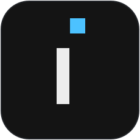
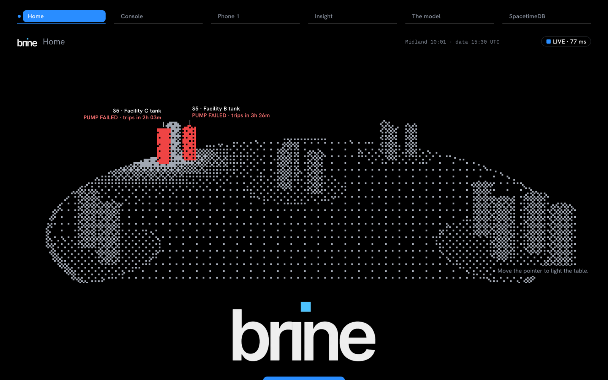
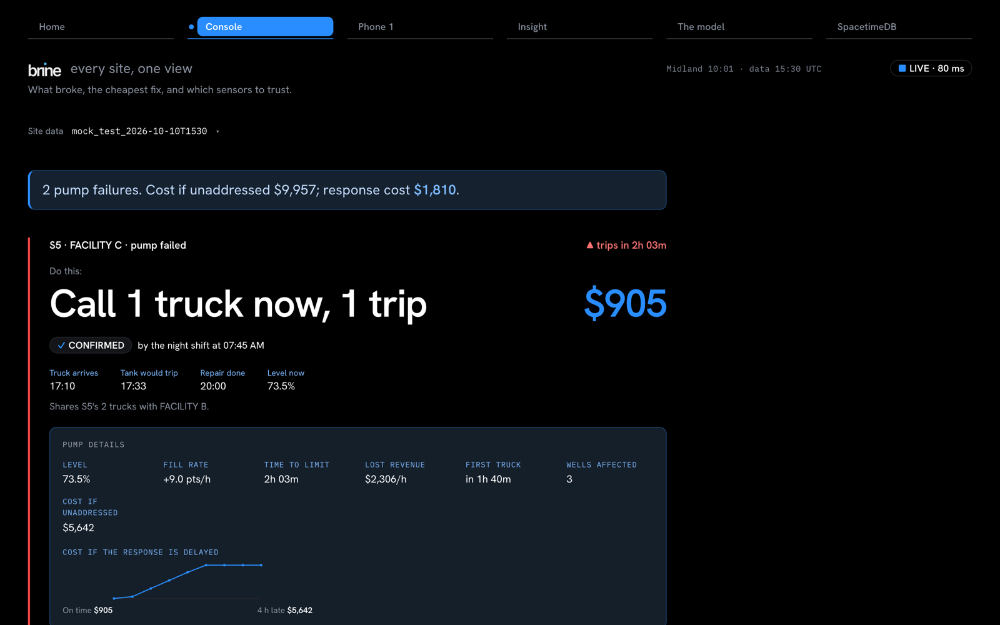
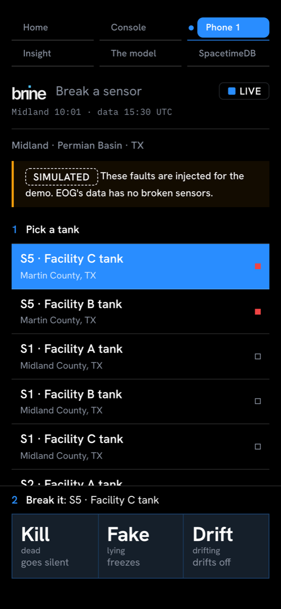
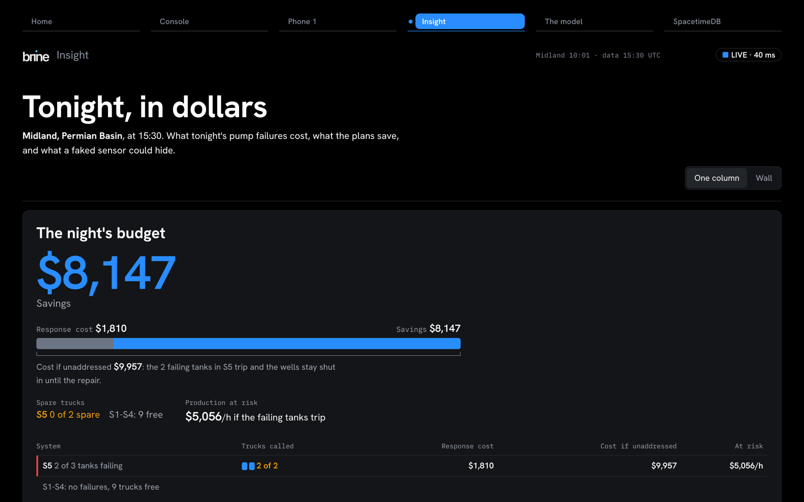
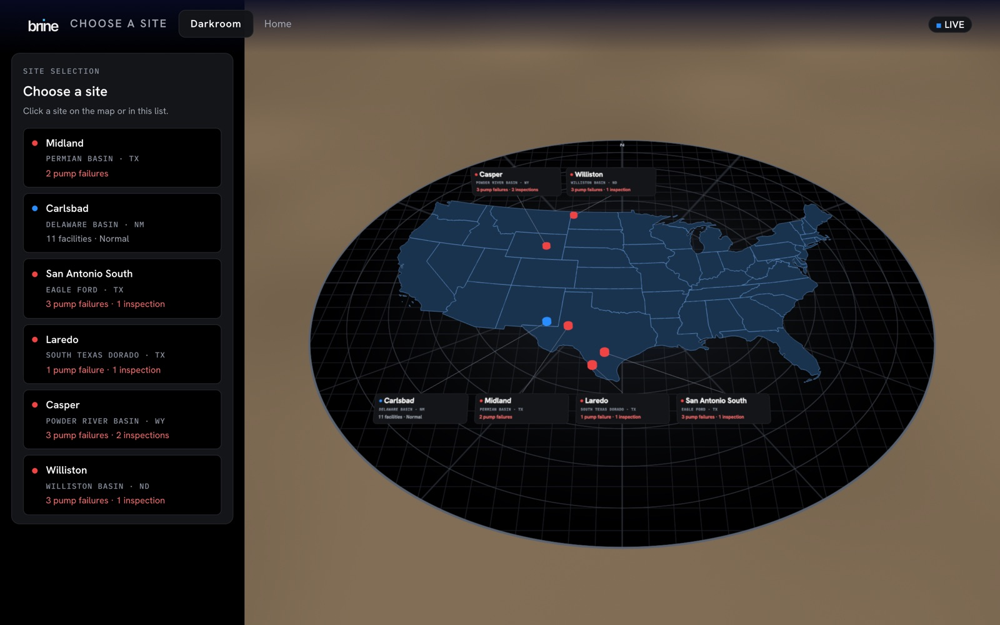

<p align="center">
  
</p>

# Brine

**Every site, one view. What broke, the cheapest fix, and which sensors to trust.**

Brine is a night-shift operations console for oil-field produced-water sites. It reads the site's telemetry, finds failing pumps before their tanks trip, plans the cheapest response across a shared truck fleet, and flags sensors whose readings disagree with physics. When the operator suspects the network itself has been compromised, Brine moves the decision to the **Darkroom**: an isolated incident room whose log can't be quietly rewritten.

Built at **HackUTD 2026: Zero Day** for EOG Resources' challenge by **Mohan Chillara, Yajat Parmar, and Sreesh Manayakar**.

     [](https://brine-hackutd.vercel.app)

[Live demo](https://brine-hackutd.vercel.app) · [Getting started](#getting-started) · [Architecture](docs/ARCHITECTURE.md) · [Running locally](docs/RUNNING.md) · [VR guide](docs/QUEST.md) · [Planner accuracy](docs/planner-accuracy.md)

<p>
  
</p>

## Why we built it

At 2 a.m. one operator watches dozens of tanks. When a pump fails, the tank behind it starts filling, and the question is not just *what broke* but *what is the cheapest thing to do about it before the tank trips and the wells shut in*. That answer depends on how many trucks are free, how far away they are, and whether the level sensor can be trusted at all.

Brine answers all three on one screen, and it is explicit about what it doesn't know. A plan is only as good as the sensor under it, so every reading is checked against a physical model of the tank, and a sensor that has gone silent, frozen or drifted is called out by name instead of being trusted.

## A look inside

<table>
  <tr>
    <td width="62%"></td>
    <td width="38%"></td>
  </tr>
  <tr>
    <td><b>Console.</b> The top problem, the plan, its cost, and what waiting would cost.</td>
    <td><b>Phone 1.</b> A teammate breaks a sensor live; every screen reacts.</td>
  </tr>
</table>

<table>
  <tr>
    <td width="50%"></td>
    <td width="50%"></td>
  </tr>
  <tr>
    <td><b>Insight.</b> The night's budget, flows, breach risk and what-if runs.</td>
    <td><b>The model.</b> Every site on a 3D map; pick one to walk it in VR.</td>
  </tr>
</table>

All telemetry comes from EOG's challenge data. Faults injected from Phone 1 are simulated and labelled as such on every screen; the extra map sites are generated from the same data.

## What's included

| Screen | What it does |
| --- | --- |
| **Console** (`/console`) | Ranks every problem on the site. For each pump failure: the countdown to a trip, the cheapest plan (call trucks, shut in a well, or do nothing), the plan's cost against the cost of doing nothing, and the sensors to check. |
| **Phone 1** (`/attack`) | A remote that injects simulated faults into a tank sensor: **Kill** (goes silent), **Fake** (freezes and lies), **Drift** (drifts off). |
| **Insight** (`/insight`) | The night's budget, inflow and outflow per facility, which tanks a faked sensor could hide, and what-if runs (pump fails, sensor spoofed, sensor dead, pipeline leak). |
| **Map** (`/map`) | Six sites in four states, each its own database, with live status. |
| **The model** (`/twin`) | The site in 3D in the browser, and in immersive VR on a Meta Quest: a table-scale miniature, an overview and a life-size walk, with the sky set to the site's local time. |
| **Darkroom** (`/box`, `/witness`, `/report`) | An isolated incident room on its own network. Members join with a one-time code, every entry is hash-chained, every phone in the room witnesses the chain, and a printable record comes from the same log. |
| **SpacetimeDB** (`/spacetime`) | The `avon` database live: row changes as they land, and which reducer writes which table. |

## How it works

**The engine runs inside the database.** Detection, planning and sensor health live in `lib/eog/` and run inside SpacetimeDB reducers, so every client sees the same board from the same transaction. A fault from Phone 1 is a reducer call; the console, the headset and Insight all rebuild from the rows it writes.

**Physics decides which sensors to trust.** A tank's level should change by inflow minus pump outflow. When a level sensor disagrees with that for long enough, it is flagged as lying, and any plan that rested on it is marked *confirmed, then changed*.

**The plan is the cheapest one that actually works.** The planner weighs trucking, shut-ins and doing nothing against a fleet shared by every facility in a system. It matches **18 of 20** of EOG's answer-key cases exactly; the other two make the same decisions with different timings ([details](docs/planner-accuracy.md)).

**The Darkroom is not connected to anything.** The two databases are never linked. A person carries a short evidence reference from the console to the box by hand. The log is tamper-evident rather than tamper-proof: each entry carries the hash of the one before it, and every witness device remembers the newest entry it has seen, so a deleted or rewritten entry shows up as `ROLLBACK DETECTED` or `TAMPERING` on every device that saw it. A one-file verifier checks the same chain from a separate laptop. An automated red-team suite runs 34 attacks against it; the [architecture notes](docs/ARCHITECTURE.md#known-limits) list exactly what it does and does not catch.

## Getting started

### Requirements

- Node 22 and npm
- [SpacetimeDB](https://spacetimedb.com) 2.14.1
- EOG's challenge data, cloned next to this repository as `../eog-data`

### Run it

```bash
git clone https://github.com/yajatp/hackutd26v2.git brine
cd brine
npm ci
git clone https://github.com/nihaal419/HackUTD-ZeroDay ../eog-data
npm run demo:avon
```

`demo:avon` starts SpacetimeDB, publishes the `avon` module, loads the data, starts the web app and prints URLs for phones on the same network. Open <http://localhost:3000>. For the Darkroom, the hosted database, phones and VR, see [running locally](docs/RUNNING.md) and the [VR guide](docs/QUEST.md).

### Run checks

```bash
npm test             # engine, rules, hash chain and witness tests
npm run lint
npx tsc --noEmit
npm run smoke        # the golden path against real reducers, on throwaway databases
```

## Repository guide

| Path | Contents |
| --- | --- |
| `app/` | Next.js screens: console, Phone 1, Insight, map, the 3D/VR model, the Darkroom and the SpacetimeDB view. |
| `lib/eog/` | The engine: loading, detection, planning, budgets, flows, breach risk and what-if runs. |
| `lib/rules/` | Sensor health, physics, faults, lockdown and the Darkroom's roles, join codes and chain status. |
| `spacetimedb/` | The `avon` module: tables and reducers that run the engine on ingest and on every fault. |
| `spacetimedb-darkroom/` | The `darkroom` module: members, incidents and the hash-chained event log. |
| `scripts/` | Boot, reset, ingest, site generation, verifiers, red team, smoke and end-to-end tests. |
| `prototypes/` | The Python reference implementation the TypeScript engine was ported from and checked against. |
| `docs/` | Architecture, setup, VR and the lockdown sequence. |

## Team

| Team member | Contribution |
| --- | --- |
| [Mohan Chillara (@mohanchillara1)](https://github.com/mohanchillara1) | Product and integration: the engine, both SpacetimeDB modules, the console and the VR model. |
| [Yajat Parmar (@yajatp)](https://github.com/yajatp) | Phone 1, multi-site map and hosting, boot and reset tooling, Quest tooling, the red-team suite and the live SpacetimeDB view. |
| [Sreesh Manayakar (@sreeshkmanayakar-beep)](https://github.com/sreeshkmanayakar-beep) | The Darkroom's look and the printed incident record. |

## Credits

- Telemetry and answer keys: EOG Resources' HackUTD 2026 challenge data ([nihaal419/HackUTD-ZeroDay](https://github.com/nihaal419/HackUTD-ZeroDay)).
- State boundaries: U.S. Census Bureau cartographic boundary files ([notice](public/geo/LICENSE.txt)).
- Fonts: Hanken Grotesk, IBM Plex Mono, Barlow, Chakra Petch and Pixelify Sans under the SIL Open Font License ([licenses](public/fonts)).

## Source availability

Source is published for review and reproducibility. No project-wide open-source license is granted. Third-party materials keep their own licenses and notices.
